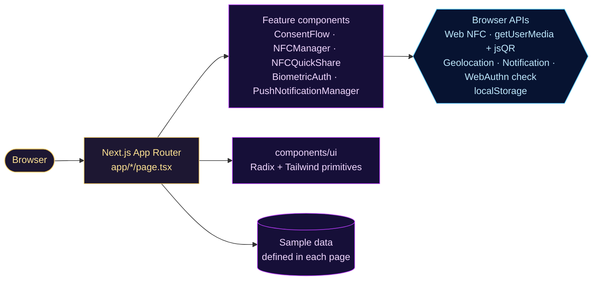

<p align="center">
  
</p>

<p align="center">
  
</p>

<p align="center">
  
  
  
  
  
</p>

**Linkaroo** is a front-end prototype for a privacy-first contact-sharing app. Your number and email stay masked, and a connection only opens up when both people agree to it. It was generated with [v0](https://v0.dev) on the Next.js App Router and has nineteen mobile-style screens, from sign-in through consent, NFC/QR sharing, emergency contacts and analytics. There is no backend: every screen runs on sample data defined in the page files, and a handful of real browser APIs are wired in.

<p align="center"><sub><code>MUTUAL CONSENT</code> ✦ <code>MASKED CONTACTS</code> ✦ <code>WEB NFC</code> ✦ <code>QR SHARE</code> ✦ <code>UI PROTOTYPE</code></sub></p>

<h2 align="center">✦ WHAT'S INSIDE ✦</h2>
<p align="center"><sub>SCREENS AND FLOWS IN THE PROTOTYPE</sub></p>

<table>
  <tr>
    <td width="33%" valign="top">🤝 <b>Consent flow</b><br><sub>Review → permissions → confirm → done. Voice calls, texts and profile sharing are approved one by one, all through a masked number.</sub></td>
    <td width="33%" valign="top">📡 <b>NFC tap-to-share</b><br><sub>Uses the Web NFC <code>NDEFReader</code> to read and write a JSON contact card, where the browser supports it.</sub></td>
    <td width="33%" valign="top">🔳 <b>QR share</b><br><sub>Generates a QR code with <code>react-qr-code</code> and scans one from the camera with <code>jsQR</code>.</sub></td>
  </tr>
  <tr>
    <td valign="top">📋 <b>Requests &amp; history</b><br><sub>Incoming connection requests, a consent history log and a bulk-consent manager.</sub></td>
    <td valign="top">🆘 <b>Emergency contacts</b><br><sub>A priority list with auto-share, location and medical-info toggles per contact.</sub></td>
    <td valign="top">📍 <b>Proximity &amp; location</b><br><sub>Reads the browser's geolocation, lets you create geofences, and simulates nearby devices.</sub></td>
  </tr>
  <tr>
    <td valign="top">🗓️ <b>Scheduling &amp; templates</b><br><sub>Connection schedules with start and end times, plus reusable sharing templates.</sub></td>
    <td valign="top">📈 <b>Analytics &amp; insights</b><br><sub>Connection stats and an "AI Insights" page. The insights are hard-coded examples; no model is called.</sub></td>
    <td valign="top">👤 <b>Profile &amp; privacy</b><br><sub>Privacy settings, plus an avatar upload that is kept in <code>localStorage</code>.</sub></td>
  </tr>
</table>

<details>
<summary><b>All routes</b> (<code>app/</code>)</summary>

<br>

| Route | Screen |
|---|---|
| `/` | Sign in |
| `/register` | Create account |
| `/dashboard` | Dashboard with contacts and quick actions |
| `/share` | Share hub |
| `/nfc-share` | NFC Tap-to-Share |
| `/qr-share` | QR Share (generate + scan) |
| `/proximity` | Proximity detection |
| `/location` | Location features and geofences |
| `/requests` | Connection requests |
| `/consent-history` | Consent management and connection details |
| `/bulk-consent` | Bulk consent management |
| `/messages` | Secure messages |
| `/emergency` | Emergency contacts |
| `/scheduling` | Connection scheduling |
| `/templates` | Connection templates |
| `/analytics` | Connection analytics |
| `/ai-insights` | AI insights (sample data) |
| `/backup-sync` | Backup &amp; sync (simulated) |
| `/profile` | Profile &amp; privacy |

</details>

<h2 align="center">◈ HOW IT'S BUILT ◈</h2>
<p align="center"><sub>CLIENT-ONLY NEXT.JS APP</sub></p>



<p align="center">
  
</p>

<p align="center"><sub>Also used: Radix UI primitives, <code>lucide-react</code> icons, <code>next-themes</code>, <code>react-qr-code</code>, <code>jsqr</code>.</sub></p>

<h2 align="center">◆ QUICK START ◆</h2>
<p align="center"><sub>RUN IT LOCALLY</sub></p>

```bash
git clone https://github.com/kamikaze1120/Linkaroo-App.git
cd Linkaroo-App
pnpm install
pnpm dev          # http://localhost:3000
```

| Script | What it does |
|---|---|
| `pnpm dev` | Start the Next.js dev server |
| `pnpm build` | Production build |
| `pnpm start` | Serve the production build |
| `pnpm lint` | Run `next lint` |

> [!NOTE]
> No environment variables are needed. Web NFC only works in browsers that ship it (on HTTPS or localhost). The camera/QR and location screens will ask for permission.

<h2 align="center">✦ SCOPE &amp; STATUS ✦</h2>
<p align="center"><sub>WHAT'S REAL AND WHAT'S MOCKED</sub></p>

- **Real in the browser:** Web NFC read/write, camera QR scanning, QR generation, geolocation, the Notification permission prompt, the WebAuthn platform-authenticator check, and avatar storage in `localStorage`.
- **Simulated:** sign-in (the button links straight to `/dashboard`), the biometric step after the availability check, nearby-device discovery, backup/sync, AI insights, and every contact, message and stat on screen.
- **Not built yet:** accounts, a database, real messaging and masked-number calling. `next.config.mjs` also skips TypeScript and ESLint errors during builds.

<details>
<summary><b>Project structure</b></summary>

<br>

```text
Linkaroo-App/
├── app/                 # App Router: one folder per screen (see routes above)
│   ├── layout.tsx       # Root layout, Inter font, dark slate theme
│   ├── page.tsx         # Sign-in screen
│   └── globals.css
├── components/
│   ├── ConsentFlow.tsx           # Multi-step consent review
│   ├── NFCManager.tsx            # Web NFC read/write
│   ├── NFCQuickShare.tsx         # Dashboard tap-to-share card
│   ├── NFCProximityDetector.tsx
│   ├── QRScanner.tsx             # Camera + jsQR
│   ├── BiometricAuth.tsx
│   ├── PushNotificationManager.tsx
│   ├── user-avatar.tsx           # Avatar upload (localStorage)
│   ├── animated-backdrop.tsx
│   ├── BottomNav.tsx
│   └── ui/                       # Radix-based primitives
├── lib/utils.ts
├── public/              # Placeholder images
├── next.config.mjs
└── package.json
```

</details>

<br>

<p align="center">
  <sub><code>◉ LINKAROO // GILDED ORBIT</code></sub><br>
  <sub>Made by <a href="https://github.com/kamikaze1120">kamikaze1120</a></sub>
</p>
